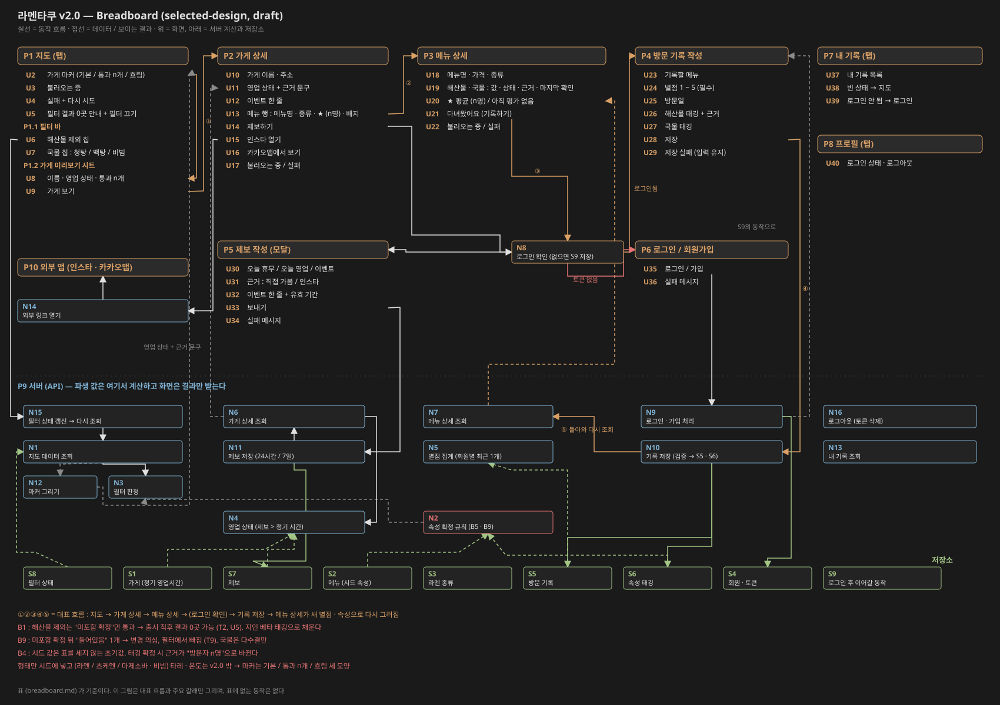

# 라멘타쿠 — Breadboard (v2.0, selected-design)

## Mode and authority

- Mode : **selected-design** (accepted selected intent 후보 — 관리자님 수락 전까지 draft)
- Selected shape : **D** (시드로 시작 + 방문자 태깅으로 확장) + 공통 부품 X1 ~ X5 (`shaping.md` Decision, 2026-11-11)
- Requirements : R0 ~ R8 **Accepted** (`shaping.md` Requirements)
- Appetite : **Accepted**, 시간 대신 범위 고정. cut line은 `shaping.md` Appetite 절
- 시드 근거 : `seed-survey.md` (30곳), `seed-attributes.md` (메뉴별 해산물 · 국물 · 종류)
- 이 문서가 기준으로 삼는 breadboard 결정 : 아래 "Breadboard 결정 (2026-11-13)"
- 현재 코드 (v1) 의 3탭 구조 (지도 · 내 기록 · 프로필) 를 이어받는다. v1 화면 구현은 참고만 한다

### Cut (v2.0에 넣지 않음, shaping에서 결정)

등급 · 랭킹 (R6, X4b), 인증샷, 가게 · 메뉴 사용자 등록 (B3), 이벤트 상세, 인스타 게시물 앱 내 표시 (D4), 사장님 참여 (C)

## Breadboard 결정 (관리자님 2026-11-13)

| # | 질문 | 결정 |
|---|---|---|
| B1 | 해산물 제외 필터에서 "모름" 메뉴 | **숨긴다.** "미포함 확정" 메뉴만 통과. 출시 전 **지인 베타**로 태깅을 모아 미포함 확정 메뉴를 만든다 |
| B2 | 국물 분류 | 국물 칸은 **청탕 / 백탕 / 비빔 (국물 없음)** + 모름. 필터 칩도 이 세 개. 츠케멘은 청탕 / 백탕 쪽 |
| B3 | 가게 단위 표시 | 통과 메뉴가 하나라도 있으면 가게를 보이고 마커에 "통과 n개". 가게 상세에서 통과 메뉴를 위로. 통과 메뉴 0개 가게는 흐린 점선 마커 |
| B4 | 시드 값과 태깅 | 시드 값은 표를 세지 않는 초기값. 태깅이 확정되면 그 값으로 바뀌고 근거가 "방문자 n명"이 된다 |
| B5 | 엇갈린 태깅 | 해산물은 안전 쪽 규칙 (아래 "속성 확정 규칙"), 국물은 다수결 |
| B6 | 별점 표시 | 0명이면 "아직 평가 없음", 1명부터 평균 + 인원수 항상 표시 ("★ 4.0 (1명)"). 지인 별점은 일반 회원 기록으로 남긴다 (시드에 별점을 넣지 않음) |
| B7 | 같은 메뉴 중복 기록 | 기록은 전부 남고, 메뉴 평균에는 회원마다 가장 최근 별점 하나만 |
| B8 | 로그인 · 제보 | 보기는 로그인 없이, 기록 · 태깅 · 제보는 로그인 필수. 휴무 · 영업 제보 24시간, 이벤트 제보 기본 7일 (제보자가 줄일 수 있음). 같은 날 영업 / 휴무 제보가 엇갈리면 "제보 엇갈림 — 인스타 확인" |
| B9 | 육수 변경 | 미포함 확정 뒤 "포함" 응답이 1개라도 오면 즉시 "변경 의심"으로 바꾸고 필터에서 뺀다. 포함 → 미포함은 일반 규칙. 국물은 다수결만 |
| B10 | 오래된 값 | 자동으로 지우지 않고 "마지막 확인 : n개월 전 · n명"을 표시한다 |

## 속성 확정 규칙 (N2)

메뉴마다 서버가 계산한다. 클라이언트는 결과만 받는다. "모르겠음" 응답은 세지 않는다.

### 해산물

| 상태 | 조건 | 해산물 제외 필터 |
|---|---|---|
| 포함 (확정) | 포함 응답 ≥ 2 이고 포함 > 미포함 | 탈락 |
| 미포함 (확정) | 미포함 응답 ≥ 2 이고 포함 응답 0 | **통과** |
| 변경 의심 | 미포함 확정이 된 뒤 포함 응답 ≥ 1 | 탈락 |
| 의견 갈림 | 응답은 있으나 위 어느 것도 아님 | 탈락 |
| 시드 값 | 응답 없음. 시드가 "포함"이면 포함 (근거 : 메뉴 설명 / 메뉴 이름) | 탈락 |
| 모름 | 응답도 시드 값도 없음 | 탈락 |

- 변경 의심에서 벗어나는 길 : 마지막 포함 응답 이후 미포함 응답이 2개 이상 쌓이면 미포함 확정으로 돌아간다. 포함 응답이 2개 이상이고 미포함보다 많아지면 포함 확정이 된다

### 국물 (청탕 / 백탕 / 비빔)

| 상태 | 조건 |
|---|---|
| 확정 | 한 값의 응답 ≥ 2 이고 다른 어느 값보다 많음 |
| 의견 갈림 | 응답 ≥ 2인 값이 둘 이상이고 동률 |
| 시드 값 | 확정 · 의견 갈림이 아니고 시드 값이 있음 |
| 모름 | 그 밖 |

국물 칩 필터는 확정 값 또는 시드 값이 고른 칩 중 하나면 통과한다. 의견 갈림 · 모름은 탈락한다.

## Places

| ID | Place | Description |
|---|---|---|
| P1 | 지도 (탭) | 마포구 지도와 가게 마커. 앱의 첫 화면 |
| P1.1 | 필터 바 | 지도 위 칩 영역. 지도와 함께 조작된다 |
| P1.2 | 가게 미리보기 시트 | 마커를 누르면 지도 아래에서 올라오는 시트. 지도는 계속 조작 가능 (같은 place) |
| P2 | 가게 상세 | 영업 상태, 이벤트, 메뉴 목록, 외부 링크 |
| P3 | 메뉴 상세 | 한 그릇의 속성 · 근거 · 별점 |
| P4 | 방문 기록 작성 | 전체 화면 폼 (뒤를 조작할 수 없음) |
| P5 | 제보 작성 | 모달 (뒤를 조작할 수 없음) |
| P6 | 로그인 / 회원가입 | 로그인이 필요한 동작에서 넘어오거나 프로필 탭에서 들어온다 |
| P7 | 내 기록 (탭) | 내가 남긴 방문 기록 목록 |
| P8 | 프로필 (탭) | 로그인 상태와 로그아웃 |
| P9 | 서버 (API) | 파생 값을 계산해 내려주는 경계 (영업 상태 · 속성 상태 · 별점 · 필터 판정) |
| P10 | 외부 앱 | 인스타그램, 카카오맵 |

## UI Affordances

| ID | Place | Component | Affordance | Control | Wires Out | Returns To |
|---|---|---|---|---|---|---|
| U1 | P1 | map | 마포구 지도 (카카오맵 WebView) | view | — | — |
| U2 | P1 | map | 가게 마커 : 필터 꺼짐 → 기본 배지 / 통과 ≥ 1 → "통과 n개" 배지 / 통과 0 → 흐린 점선 | tap | → U8 | — |
| U3 | P1 | map | 지도 불러오는 중 | view | — | — |
| U4 | P1 | map | 불러오기 실패 + 다시 시도 | tap | → N1 | — |
| U5 | P1 | map | 필터 결과 0곳 안내 : "해산물 없는 것으로 확인된 메뉴가 아직 없어요" + 필터 끄기 | tap | → U6 | — |
| U6 | P1.1 | filter | 해산물 제외 칩 (켜기 / 끄기) | toggle | → N15 | — |
| U7 | P1.1 | filter | 국물 칩 : 청탕 / 백탕 / 비빔 (여러 개 선택 가능) | toggle | → N15 | — |
| U8 | P1.2 | sheet | 가게 이름 · 영업 상태 문구 · 통과 메뉴 n개 (필터 켰을 때) | view | — | — |
| U9 | P1.2 | sheet | 가게 보기 | tap | → P2 | — |
| U10 | P2 | header | 가게 이름 · 주소 | view | — | — |
| U11 | P2 | status | 영업 상태 + 근거 문구 (예 : "영업 중 · 정기 영업시간 기준", "휴무 · 제보 (인스타에서 봄) · 2시간 전", "제보 엇갈림 — 인스타 확인", "모름") | view | — | — |
| U12 | P2 | status | 이벤트 한 줄 (유효한 것만, 없으면 숨김) | view | — | — |
| U13 | P2 | menu list | 메뉴 행 : 메뉴명 · 종류 · 형태 · 별점 ("★ 4.0 (3명)" / "아직 평가 없음") · 해산물 · 국물 배지. 필터를 켰으면 통과 메뉴가 위 | tap | → P3 | — |
| U14 | P2 | actions | 제보하기 | tap | → N8 | — |
| U15 | P2 | actions | 인스타 열기 (영업 상태가 "제보 엇갈림"이면 강조) | tap | → N14 | — |
| U16 | P2 | actions | 카카오맵에서 보기 | tap | → N14 | — |
| U17 | P2 | state | 불러오는 중 / 실패 + 다시 시도 | tap | → N6 | — |
| U18 | P3 | header | 메뉴명 · 가격 · 종류 · 형태 (라멘 / 츠케멘 / 마제소바 · 비빔) | view | — | — |
| U19 | P3 | attributes | 해산물 · 국물의 값 + 상태 (확정 / 변경 의심 / 의견 갈림 / 시드 / 모름) + 근거 ("메뉴 설명", "메뉴 이름", "방문자 3명") + "마지막 확인 : n개월 전" | view | — | — |
| U20 | P3 | rating | 별점 평균 + 인원수 / "아직 평가 없음" | view | — | — |
| U21 | P3 | actions | 다녀왔어요 (기록하기) | tap | → N8 | — |
| U22 | P3 | state | 불러오는 중 / 실패 + 다시 시도 | tap | → N7 | — |
| U23 | P4 | form | 기록할 메뉴 (P3에서 넘어온 메뉴, 바꿀 수 없음) | view | — | — |
| U24 | P4 | form | 별점 1 ~ 5 (필수) | input | — | — |
| U25 | P4 | form | 방문일 (기본 오늘) | input | — | — |
| U26 | P4 | form | 해산물 태깅 : 들어있음 / 안 들어있음 / 모르겠음 + 근거 (메뉴판에 적혀 있음 / 먹어보니 그랬음) (선택) | input | — | — |
| U27 | P4 | form | 국물 태깅 : 청탕 / 백탕 / 비빔 / 모르겠음 (선택) | input | — | — |
| U28 | P4 | form | 저장 | tap | → N10 | — |
| U29 | P4 | form | 저장 실패 메시지 (입력 유지, 다시 시도 가능) | view | — | — |
| U30 | P5 | form | 제보 종류 : 오늘 휴무 / 오늘 영업 / 이벤트 | input | — | — |
| U31 | P5 | form | 근거 : 직접 가봄 / 인스타에서 봄 | input | — | — |
| U32 | P5 | form | 이벤트 문구 한 줄 + 유효 기간 (기본 7일, 줄일 수 있음). 종류가 이벤트일 때만 보임 | input | — | — |
| U33 | P5 | form | 보내기 | tap | → N11 | — |
| U34 | P5 | form | 보내기 실패 메시지 | view | — | — |
| U35 | P6 | form | 로그인 / 회원가입 | tap | → N9 | — |
| U36 | P6 | form | 로그인 실패 메시지 | view | — | — |
| U37 | P7 | list | 내 기록 목록 : 메뉴명 · 가게 · 별점 · 방문일 (최신순, 같은 메뉴 여러 번이면 모두 보임) | tap | → P3 | — |
| U38 | P7 | list | 빈 상태 : "아직 기록이 없어요" + 지도에서 찾아보기 | tap | → P1 | — |
| U39 | P7 | list | 로그인 안 됨 : 로그인하기 | tap | → P6 | — |
| U40 | P8 | profile | 로그인 상태 · 로그아웃 (로그인 안 됐으면 로그인하기) | tap | → N16 / → P6 | — |

## Non-UI Affordances

| ID | Place | Component | Affordance | Control | Wires Out | Returns To |
|---|---|---|---|---|---|---|
| N1 | P9 | map | 지도 데이터 조회 (S8의 필터 조건 포함) : 가게별 좌표 · 영업 상태 · 통과 메뉴 수 | call | → N2, → N3, → N4 | → N12, → U8, → U3 / U4, → U5 (통과 0곳) |
| N2 | P9 | attributes | 메뉴 속성 확정 계산 ("속성 확정 규칙") : 값 · 상태 · 근거 · 마지막 확인 · 인원 | call | — | → N3, → N6, → N7 |
| N3 | P9 | filter | 필터 판정 : 메뉴별 통과 여부 → 가게별 통과 수. 해산물 제외는 "미포함 확정"만, 국물 칩은 확정 · 시드 값이 칩과 같을 때, 둘 다 켜면 AND | call | — | → N1, → N6 |
| N4 | P9 | status | 영업 상태 계산 : 유효 제보 → 제보 값 / 같은 날 엇갈림 → "제보 엇갈림" / 제보 없음 → 정기 영업시간 (영업 중 · 브레이크 · 영업 종료 · 정기 휴무) / 정기 시간도 없음 → 모름. 근거 문구 포함 | call | — | → N1, → N6 |
| N5 | P9 | rating | 별점 집계 : 회원마다 가장 최근 기록 하나 → 평균 · 인원수 | call | — | → N6, → N7 |
| N6 | P9 | shop | 가게 상세 조회 | call | → N2, → N3, → N4, → N5 | → U10, → U11, → U12, → U13, → U17 |
| N7 | P9 | menu | 메뉴 상세 조회 | call | → N2, → N5 | → U18, → U19, → U20, → U22 |
| N8 | P2 / P3 | auth | 로그인 확인 : 토큰 있음 → 원래 화면 (P4 · P5) / 없음 → 하려던 동작을 S9에 저장하고 P6 | call | → P4, → P5, → P6 | — |
| N9 | P9 | auth | 로그인 · 가입 처리 : 성공 → 토큰을 S4에 저장하고 S9의 동작으로 이어감 (없으면 이전 화면) / 실패 → 메시지 | call | → P4, → P5 | → U36 |
| N10 | P9 | record | 기록 저장 : 검증 (별점 필수, 방문일 ≤ 오늘, 로그인 회원) → S5 쓰기, 태깅이 있으면 S6 쓰기 → P3으로 돌아가 다시 조회 | call | → N7 | → U29 (실패) |
| N11 | P9 | report | 제보 저장 : 만료 시각 계산 (휴무 · 영업 24시간, 이벤트 기본 7일 또는 지정) → S7 쓰기 → P2로 돌아가 다시 조회 | call | → N6 | → U34 (실패) |
| N12 | P1 | map | 마커 그리기 (WebView 안에서 `buildMarkerSvg` 로 SVG 문자열 생성 후 주입) : 필터 꺼짐 / 통과 ≥ 1 / 통과 0 세 모양 | call | — | → U2 |
| N13 | P9 | record | 내 기록 조회 (최신순) | call | — | → U37, → U38 |
| N14 | client | link | 외부 링크 열기 (인스타 계정 · 카카오 장소 ID) | call | → P10 | — |
| N15 | P1 | filter | 필터 상태 갱신 → 지도 다시 조회 | call | → N1 | — |
| N16 | client | auth | 로그아웃 : S4 토큰 삭제 | call | — | → U40 |

## Stores

| ID | Place | Store | Description | 쓰는 곳 | 읽는 곳 |
|---|---|---|---|---|---|
| S1 | P9 | 가게 | 이름, 좌표 · 주소 (공공데이터), 정기 영업시간 · 정기 휴무, 인스타 계정, 카카오 장소 ID | 시드 | N1, N4, N6, N14 |
| S2 | P9 | 메뉴 (`ShopRamen`) | 가게, 종류, 이름, 가격, 형태, 시드 속성 (해산물 · 국물) + 근거 | 시드 | N2, N6, N7 |
| S3 | P9 | 라멘 종류 (`Ramen`) | 11개 이름표 (`seed-attributes.md`) | 시드 | N6, N7 |
| S4 | client + P9 | 회원 · 로그인 토큰 | 회원 계정, 기기에 저장된 토큰 | N9, N16 | N8, N10, N11, N13, U40 |
| S5 | P9 | 방문 기록 | 회원, 메뉴, 별점, 방문일, 작성 시각 | N10 | N5, N13 |
| S6 | P9 | 속성 태깅 | 회원, 메뉴, 해산물 응답 + 근거, 국물 응답, 시각 | N10 | N2 |
| S7 | P9 | 제보 | 가게, 종류, 근거, 이벤트 문구, 만료 시각, 회원 | N11 | N4, N6 |
| S8 | P1 | 필터 상태 | 해산물 제외 켜짐 여부, 고른 국물 칩 | N15 | N1 |
| S9 | client | 로그인 후 이어갈 동작 | 기록하기 (메뉴 ID) / 제보하기 (가게 ID) | N8 | N9 |

## Requirement realization

| R | 요구 | Shape part | Breadboard IDs | 관찰 가능한 결과 | 흐름 |
|---|---|---|---|---|---|
| R0 | 국물 속성으로 포함 · 제외 | X1, X2, D2 | U6, U7, N15, N1, N3, N2, S2, S6, N12, U2 | 해산물 제외를 켜면 "미포함 확정" 메뉴가 없는 가게가 흐려지고, 국물 칩대로 가게가 걸러진다 | T2, T3 |
| R1 | 메뉴 별점으로 정통성을 알아감 | X3 | U13, U20, N5, S5 | 별점이 보이는 모든 자리에 메뉴명과 인원수가 붙어 있다 | T4, T5 |
| R2 | 인스타 없이 휴무 · 이벤트 | D1, D3 | S1, S7, N4, U11, U12, U14, N11 | 정기 휴무일과 제보된 임시 휴무 · 이벤트가 가게 상세에 보인다 | T1, T10, T12 |
| R3 | 불확실하면 확실한 척 안 함 | X5 | N4, U11, N2, U19 | 영업 상태 · 속성에 근거 문구가 붙고, 근거가 없으면 "모름"으로 보인다 | T10, T11, T5 |
| R4 | 메뉴 단위 | X1, X3 | S2, S6, U13, U19, U26, U27 | 같은 가게의 두 메뉴가 서로 다른 해산물 · 국물 값을 가진다 | T4 |
| R5 | 다녀온 메뉴 기록 | X4a | U21, N8, P4, U24 ~ U28, N10, S5, U37 | 저장한 기록이 내 기록에 나타난다 | T6, T7, T14 |
| R6 | 등급 + 비교 | X4b | — | **cut (v2.0 밖)** | — |
| R7 | 정보가 비어도 쓸모 있음 | D1 | S1, S2, N1, N4, U2, U8, U11 | 첫 실행에 30곳 마커와 정기 영업시간 기준 상태가 보인다. 단 해산물 제외 필터는 B1에 따라 비어 있을 수 있다 (아래 Notes) | T1, T2 |
| R8 | 운영자 혼자 다 채우지 않음 | D2 | U26, U27, N10, S6, N2 | 방문자 태깅만으로 메뉴 속성이 확정 · 변경된다. 가게 · 메뉴 추가는 v2.0에서도 운영자 몫 (B3 cut) | T7, T8, T9 |

## Behavior traces

| # | Scenario | Entry | Control path | Decision / branch | State / data effect | Observable consequence |
|---|---|---|---|---|---|---|
| T1 | 앱을 열면 지도에 30곳이 보인다 | P1 진입 | N1 → N4, N3 | 필터 꺼짐 | 읽기 S1, S2, S8 | U3 → N12 → U2 기본 배지 30개. 실패 시 U4 |
| T2 | 해산물 제외를 켠다 (출시 직후) | U6 | U6 → N15 → N1 → N3 (← N2) | 모든 메뉴가 미포함 확정이 아님 → 통과 0곳 | 쓰기 S8, 읽기 S2, S6 | 모든 마커가 흐린 점선 (U2), U5 안내 |
| T2b | 해산물 제외를 켠다 (지인 베타 이후) | U6 | U6 → N15 → N1 → N3 (← N2) | 일부 메뉴가 미포함 확정 → 통과 ≥ 1 | 쓰기 S8 | 해당 가게는 "통과 n개" 배지, 나머지는 흐린 점선 |
| T3 | 국물 칩 "청탕"을 고른다 | U7 | U7 → N15 → N1 → N3 (← N2) | 확정 또는 시드 값이 청탕인 메뉴만 통과 | 쓰기 S8 | 통과 가게만 배지 (예 : 소월옥, 라멘롱시즌, 이리에) |
| T4 | 가게를 살펴본다 | U2 | U2 → U8 → U9 → P2 → N6 → N2, N3, N4, N5 | 필터 켜짐이면 통과 메뉴를 위로 정렬 | 읽기 S1, S2, S3, S5, S6, S7 | U10 ~ U13 : 메뉴마다 메뉴명 · 종류 · 별점 · 속성 배지 |
| T5 | 평가가 없는 메뉴를 연다 | U13 | U13 → P3 → N7 → N2, N5 | 기록 0개 / 태깅 0개 | 읽기 S2, S5, S6 | U20 "아직 평가 없음", U19 시드 값 + 근거 "메뉴 설명" 또는 "모름" |
| T6 | 로그인 없이 기록하기를 누른다 | U21 | U21 → N8 | 토큰 없음 | 쓰기 S9 (기록하기, 메뉴 ID) | P6 → U35 → N9 성공 → S4 쓰기 → P4 (같은 메뉴) / 실패 → U36 |
| T7 | 기록을 저장한다 (태깅 포함) | U28 | U28 → N10 | 검증 통과 | 쓰기 S5, S6 | P3으로 돌아가 N7 → U20 평균 · 인원 갱신, U19 상태 갱신 (응답 수가 기준에 못 미치면 시드 값 그대로) |
| T7b | 기록 저장이 실패한다 | U28 | U28 → N10 | 검증 실패 또는 네트워크 오류 | 쓰기 없음 | U29, 입력 유지 |
| T8 | 두 번째 "안 들어있음" 태깅으로 미포함이 확정된다 | U28 | U28 → N10 → N7 (← N2) | 미포함 ≥ 2, 포함 0 → 미포함 확정 | 쓰기 S6 | U19 "미포함 · 방문자 2명 · 마지막 확인 오늘". 이후 T2b에서 이 메뉴의 가게가 통과 |
| T9 | 미포함 확정 메뉴에 "들어있음"이 들어온다 (육수 변경) | U28 | U28 → N10 → N7 (← N2) | 확정 뒤 포함 ≥ 1 → 변경 의심 | 쓰기 S6 | U19 "변경 의심 — 다시 확인 중". 해산물 제외 필터에서 탈락 (U2 흐림 또는 통과 수 감소) |
| T10 | 인스타에서 본 임시 휴무를 제보한다 | U14 | U14 → N8 → P5 → U30, U31 → U33 → N11 | 로그인됨, 휴무 · 인스타에서 봄 | 쓰기 S7 (만료 24시간 뒤) | P2 → N6 → N4 → U11 "휴무 · 제보 (인스타에서 봄) · 방금". 24시간 뒤 정기 영업시간 기준으로 돌아감 |
| T11 | 같은 날 영업 · 휴무 제보가 엇갈린다 | U33 | U33 → N11 → N6 → N4 | 유효한 휴무 제보와 영업 제보가 함께 있음 | 쓰기 S7 | U11 "제보 엇갈림 — 인스타 확인", U15 강조 |
| T12 | 이벤트를 제보한다 | U33 | U33 → N11 → N6 | 종류 = 이벤트, 유효 7일 (또는 지정) | 쓰기 S7 | U12에 한 줄 표시, 만료 뒤 숨김 |
| T13 | 인스타 · 카카오맵으로 나간다 | U15 / U16 | → N14 → P10 | — | 읽기 S1 | 외부 앱 열림 |
| T14 | 같은 메뉴를 두 번 기록한다 | U28 (두 번째) | U28 → N10 → N7 (← N5) | 같은 회원 · 같은 메뉴 | 쓰기 S5 (기록 2개) | U37 두 기록 모두 보임, U20 평균에는 최근 별점 하나만 반영 |
| T15 | 내 기록 탭을 연다 | P7 진입 | N13 | 로그인됨 · 기록 있음 / 없음 / 로그인 안 됨 | 읽기 S4, S5 | U37 목록 / U38 빈 상태 / U39 로그인하기 |
| T16 | 로그아웃한다 | U40 | U40 → N16 | — | S4 토큰 삭제 | U40 "로그인하기"로 바뀜. 이후 U21 · U14는 T6 경로 |

## Reverse trace (관찰 결과 → 들어오는 선)

| 관찰 결과 | 직접 들어오는 곳 | 거슬러 올라간 시작점 · 쓰는 곳 | 미해결 | 상태 |
|---|---|---|---|---|
| U2 마커 | N12 | N1 ← P1 진입 (T1), N15 ← U6 · U7, U4 다시 시도 | — | ok |
| U5 0곳 안내 | N1 | U6 · U7 → N15 → N1 | — | ok |
| U8 미리보기 | N1 | U2 탭 + N1 결과 | — | ok |
| U11 영업 상태 | N6 (← N4) | N4 읽기 S1 (시드), S7 (← N11 ← U33) | — | ok |
| U12 이벤트 | N6 | S7 (← N11 ← U33) | — | ok |
| U13 메뉴 행 | N6 (← N2, N3, N5) | S2 (시드), S6 · S5 (← N10 ← U28), S8 (← N15) | — | ok |
| U19 속성 상세 | N7 (← N2) | S2 (시드), S6 (← N10 ← U28) | — | ok |
| U20 별점 | N7 (← N5) | S5 (← N10 ← U28) | — | ok |
| U29 저장 실패 | N10 | U28 | — | ok |
| U34 제보 실패 | N11 | U33 | — | ok |
| U36 로그인 실패 | N9 | U35 | — | ok |
| U37 · U38 내 기록 | N13 | S5 (← N10), P7 진입 | — | ok |
| U40 로그인 상태 | S4, N16 | S4 (← N9), N16 (← U40) | — | ok |
| P4 · P5 진입 | N8, N9 | U21 · U14 (로그인됨), S9 (← N8) + 로그인 성공 | — | ok |
| P10 외부 앱 | N14 | U15, U16 | — | ok |

## Visual breadboard

`breadboard.svg` — 왼쪽에서 오른쪽으로 대표 흐름 (지도 → 가게 상세 → 메뉴 상세 → 기록 작성 → 메뉴 상세로 돌아옴) 을 따라가고, 아래 줄에 서버 계산과 저장소를 둔다. 실선은 동작 흐름, 점선은 데이터 · 보이는 결과다.

## Notes

- **R7과 B1의 관계 (관리자님이 받아들인 위험)** : 해산물 제외 필터는 B1에 따라 출시 직후 비어 있을 수 있다 (T2). 지도 자체는 필터를 끄면 30곳이 모두 보이므로 R7은 기본 지도에서 충족한다. 필터의 빈 상태는 지인 베타 태깅으로 줄인다. 그래서 공개 전에 **지인 베타**가 필요하고, 이는 슬라이스 순서에 반영해야 한다
- **타레 · 형태 · 온도 (X1의 나머지 축)** : 형태만 시드에 넣는다 (관리자님 2026-11-13, `seed-attributes.md` 형태 칸). 형태는 메뉴 행 · 메뉴 상세에 표시만 하고 필터에는 쓰지 않는다. 타레 · 온도와 v1 마커 색 (타레 × 청탁) 은 v2.0 밖이며, 마커는 "기본 / 통과 n개 / 흐림" 세 모양으로 그린다
- 영업 상태의 "영업 중 / 브레이크 / 영업 종료 / 정기 휴무" 판정은 서버 시각 (Asia/Seoul) 기준이다
- 좌표는 공공데이터 출처 (U4 결정), 카카오 장소 ID는 링크 (N14) 에만 쓴다
- 별점 · 태깅 · 제보에 대한 신고 · 삭제 기능은 v2.0에 없다. 악용은 로그인 필수와 B5 · B9 규칙으로만 막는다

## 배포 (관리자님 2026-11-13)

- 지인 베타는 **Expo 테스트 배포**로 한다
- Google Play 정식 등록 조건 (새 개인 개발자 계정) : 비공개 테스트에 **테스터 12명이 14일 연속** 참여해야 프로덕션 출시를 신청할 수 있다. 지인 베타 기간에 이 조건을 함께 채운다 (Play Console 도움말 기준, 2026-11-13 확인)
- 지인 베타 기간의 기록 · 태깅이 B1 (해산물 제외 필터) 의 미포함 확정을 만든다. 그래서 지인 베타는 기록 · 태깅 기능이 들어간 뒤에 시작한다 (슬라이스 순서 조건)
- 정식 등록에는 서버 호스팅과 개인정보 처리방침 URL이 필요하다. 호스팅 선택은 슬라이스 단계에서 정한다

## Open questions

- 없음 (2026-11-13 기준). 수락 후 슬라이스로 넘어간다
